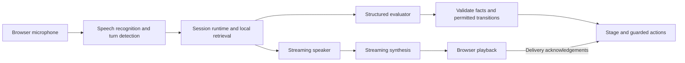

# Libretto

**Voice workflows, written in YAML.**

[](https://github.com/Prasad-178/libretto/actions/workflows/ci.yml)

[Live demo](https://libretto.prasadjs.me) · [Architecture](docs/architecture.md) · [Testing guide](docs/testing.md) · [Speech adapters](docs/speech-providers.md) · [Access and security](docs/security.md)

Libretto is a Python workflow engine and React studio for building stateful voice agents. Define stages, prompts, fields, transitions, knowledge and actions in YAML; inspect the generated workflow; then test it over voice or text while watching state, sources and tool receipts.

The bundled agent is Jamie, the receptionist at **Northline Workspace**, a fictional coworking space. Ask about memberships or rooms, request a transfer, or leave a message after a simulated failed transfer. Transfers and message captures are session-only simulations; they do not contact anyone or create a real ticket.

The runtime constrains transitions and action prerequisites. Language understanding and generated wording remain probabilistic: a YAML graph does not make an LLM deterministic.

## Try it

Open **[libretto.prasadjs.me](https://libretto.prasadjs.me)**. Browse the Workflow, Agent, YAML and Knowledge base tabs without connecting to a provider.

To start a conversation, open **API connection** and enter your own keys:

| Mode | Required keys |
| --- | --- |
| Text | OpenRouter |
| Voice | OpenRouter and a direct Deepgram key with access to the configured Flux models |

API usage is billed by those providers. The public demo has no funded shared provider keys. Keys stay in tab/session memory, are sent to the backend over HTTPS/WSS, and are excluded from browser storage and app-generated exports. See the [credential boundaries](docs/security.md).

A few natural things to try:

- “What membership options do you have?” Then: “What about meeting rooms?”
- “Can I speak to Maya in billing?” Approve the destination and observe the simulated transfer result.
- “I'd like to leave a message.” Supply invented details, correct the callback number, and confirm the new readback.
- Ask about an unpublished discount or try to book a room. The agent should explain its limits without inventing a policy or claiming a booking.

The test panel includes **15 scenarios** with fictional data, expected sources and selectable transfer outcomes. Use **State**, **Sources** and **Trace** to inspect what happened. Calls end after five minutes; a new call starts fresh. Prefer headphones when evaluating interruptions.

## What is implemented

- **Editable YAML and workflow visualization.** Prompt forms and YAML share one definition. Apply validates it; each test runs an immutable definition snapshot. The canvas is a visualization, not a node editor.
- **Concurrent speaking and evaluation.** A streaming speaker produces the reply while a separate structured evaluator proposes facts and routing. Ordinary speech has no preceding LLM classifier.
- **Runtime-owned state and actions.** Typed fields, allowed graph edges, confirmation checks and session-local action deduplication constrain execution. Corrections invalidate previous confirmations.
- **Streaming audio and interruption handling.** Browser AudioWorklets capture/play PCM. Work epochs reject stale output; playback acknowledgements distinguish generated speech from delivered speech.
- **Document retrieval.** Local BM25 retrieves relevant Markdown passages, including context for short follow-ups. Sources are visible in the test panel.
- **Voice-call controls.** A lightweight CSS orb reflects call state, with a spoken welcome, mute/end controls and responsive layouts.
- **Diagnostics and evaluations.** Session exports include stage/fact/tool events, retrieval duration and estimated audio/playback latency. Local checks and opt-in real-model evaluations are separate.

## Run locally

Requires **Python 3.12+**, [uv](https://docs.astral.sh/uv/) and **Node.js 22.12+** (24 recommended).

```sh
git clone https://github.com/Prasad-178/libretto.git
cd libretto
uv sync --locked
npm --prefix web ci
npm --prefix web run build
uv run libretto serve
```

Open **http://127.0.0.1:8000** and enter keys in Connection settings. Alternatively, copy `.env.example` to `.env` and set `OPENROUTER_API_KEY` and `DEEPGRAM_API_KEY` there. Never put provider credentials in YAML or `VITE_` environment variables.

For frontend development, keep the backend running and start:

```sh
npm --prefix web run dev
```

Vite proxies `/api` and its WebSocket to port 8000. A frontend build is required when serving the compiled studio directly from the Python server.

## A workflow is a file

This complete example is [examples/minimal.yaml](examples/minimal.yaml):

```yaml
version: 1
id: tiny-survey
name: A one-question survey
start: question
shared_prompt: Speak English. Ask one question at a time.
fields:
  answer: {type: string, description: The user's answer}
nodes:
  question:
    kind: conversation
    title: One question
    prompt: Ask what makes a useful demo. Thank the caller when answered.
    edges:
      - {id: answered, to: end, condition: The user answered or declined the question.}
  end: {kind: end, title: Finished}
```

Validate or inspect a definition without a provider call:

```sh
uv run libretto validate examples/minimal.yaml
uv run libretto graph examples/receptionist.yaml
```

The [receptionist definition](examples/receptionist.yaml) adds shared and stage-specific prompts, typed facts, knowledge sources, conversation/action nodes, readback templates and speech settings. The [architecture guide](docs/architecture.md) explains scheduling, transition commits and action execution.

## How a voice turn works



The speaker and evaluator receive a fixed stage snapshot. A valid pending transition commits at a generation boundary; it does not change a reply's prompt midway through streaming. Actions require authoritative facts and confirmation, and voice actions wait for playback. A runtime-generated welcome and validated readback need no speaker request.

Libretto owns the orchestration. OpenRouter supplies the current LLM API; Deepgram supplies recognition, turn detection and synthesis. Flux TTS accepts raw text deltas and chooses synthesis boundaries inside the provider. There is no local sentence-completion model or per-word synthesis request.

Recognition and synthesis have separate adapter contracts. **Deepgram is the only shipped speech provider today**; another provider requires an implemented and registered adapter, not just a new YAML name. See [speech provider integration](docs/speech-providers.md).

## Verify and evaluate

```sh
uv run pytest -q
uv run ruff check src tests app.py
uv run libretto evaluate
npm --prefix web test
npm --prefix web run build
```

[GitHub Actions](https://github.com/Prasad-178/libretto/actions/workflows/ci.yml) runs those checks on pushes and pull requests with no provider keys or paid API calls. The suite covers concurrency, stale work, confirmation/readback guards, tool receipts, access limits, provider contracts, audio ordering and timing calculations.

`libretto evaluate` runs eight curated Northline retrieval checks offline and writes a report under ignored `.local/evaluations/`. The explicitly opted-in command below makes **paid OpenRouter requests** for two fictional workflows: message/corrected-contact/capture and unavailable transfer.

```sh
uv run libretto evaluate --live
```

Those cases use real model calls and simulated business tools. They do not measure microphone or TTS latency. Use `--output PATH` to retain separate reports. See the [testing guide](docs/testing.md) and [verification evidence](docs/evidence.md).

The State tab and session export report mean/median retrieval time and estimated time to first speech. Browser measurements separate confirmed-endpoint-to-audio/playback from microphone-activity-to-playback estimates. Greetings, readbacks and tool-result follow-ups are excluded from ordinary-reply summaries. **These are diagnostics, not a controlled acoustic latency benchmark.**

## Deployment and limits

The current demo runs on Vercel at **https://libretto.prasadjs.me**. `app.py` is the FastAPI entrypoint; `vercel.json` builds the frontend and allows a 300-second function lifetime. One WebSocket owns one in-memory session. There is no database or reconnect recovery; setup time can make the hosting limit end a call slightly before the five-minute timer.

Vercel deployments default to visitor keys, even if provider keys are accidentally present in the environment. A shared budget requires explicit operator opt-in with `LIBRETTO_ALLOW_HOSTED_KEYS=true`. Provider usage is billed separately from hosting, and platform included limits still apply. See [security and public-traffic limits](docs/security.md).

Current scope:

- English only; browser voice and text, with no telephony.
- A small bundled Markdown corpus with lexical retrieval; no embeddings, vector database or large-corpus scalability claim.
- Simulated transfers and message capture; no durable business delivery, account access, payments or bookings.
- No visual node editing, distributed application rate limiter or deployment-wide spending meter.
- Workflow and session exports are explicit downloads. They can contain conversation details; review them before sharing.

## Find your way around

| Path | Responsibility |
| --- | --- |
| [docs/architecture.md](docs/architecture.md) | Pipeline, state model, scheduling and extension boundaries |
| [src/libretto/runtime.py](src/libretto/runtime.py) | Session state, concurrent work, transitions, readbacks and action guards |
| [src/libretto/schema.py](src/libretto/schema.py) | Validated YAML schema and graph references |
| [src/libretto/speech.py](src/libretto/speech.py) | Provider-neutral speech coordination and registration |
| [src/libretto/providers](src/libretto/providers) | OpenRouter and Deepgram adapters |
| [src/libretto/retrieval.py](src/libretto/retrieval.py) | Local Markdown indexing and lexical retrieval |
| [web/src](web/src) | React studio, workflow canvas, browser audio and timing |
| [examples](examples) | Fictional receptionist, minimal workflow, knowledge and scenarios |
| [docs/testing.md](docs/testing.md) | Test paths and expected demo behavior |
