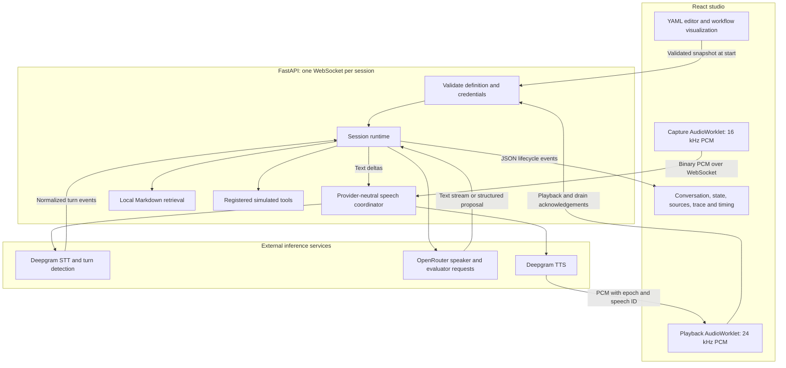
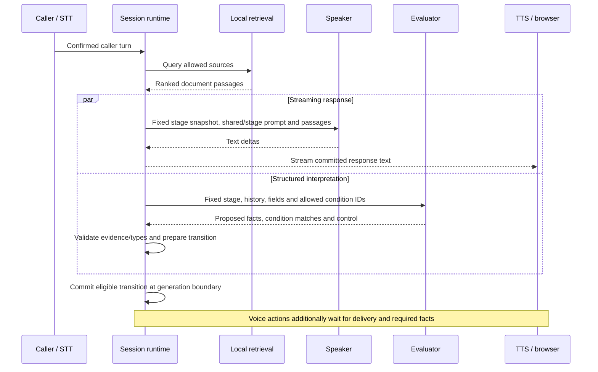

# Libretto architecture

[README](../README.md) · [Example workflow](../examples/receptionist.yaml) · [Speech adapters](speech-providers.md) · [Testing](testing.md) · [Security](security.md)

Libretto separates conversational output from workflow authority. A streaming model speaks while a structured evaluator interprets the same caller turn. The Python runtime owns the accepted facts, active stage, permitted transitions, cancellation and action execution. The browser owns microphone capture, playback and the editor/test interface.

This document describes the shipped prototype. A constrained graph does not guarantee correct language understanding, correct model answers or real business delivery.

## Components and ownership

| Component | Owns | Does not own |
| --- | --- | --- |
| React studio | Editor state, YAML/forms synchronization, graph visualization, call controls and session diagnostics | Authoritative fact validation or permission to execute actions |
| FastAPI connection handler | Credential checks, definition compilation, transport framing, session lifetime and cleanup | A durable or reconnectable conversation store |
| `Session` runtime | Concurrent tasks, fixed generation snapshots, validated facts, transition commits, readbacks and action guards | Speech recognition, synthesis or reliable semantic interpretation |
| Retrieval index | Bundled-document chunks, lexical ranking and source filtering | A remote search service, embeddings or a semantic reranker |
| Speech coordinator | Normalized STT/TTS events, runtime integration, speech/message binding and audio framing | Vendor packet formats or provider model internals |
| Provider adapters | API connections, provider protocols, error mapping and declared capabilities | Business workflow decisions |
| Tool registry | Allowlisted simulated transfers/message capture and actual result receipts | Real phone routing, external tickets or durable delivery |

## A definition becomes a fixed session configuration

[`schema.py`](../src/libretto/schema.py) parses bounded YAML with a safe loader and validates it with Pydantic. Validation checks node/field references, graph reachability, tool declarations, knowledge references and readback placeholders. Definitions are limited to 100 KB, 64 nodes and 64 fields; aliases, duplicate keys and excessive nesting are rejected.

The hosted editor cannot import code, register a tool, choose an arbitrary provider URL or read an arbitrary knowledge directory. [`server.py`](../src/libretto/server.py) compiles edits against the server's speech registry, tool registry and bundled knowledge allowlist.

A workflow contains:

| Setting | Purpose |
| --- | --- |
| `shared_prompt` | Instructions included in each speaker generation, alongside its stage prompt |
| `welcome` | Optional literal startup speech, emitted after voice transport is ready without a speaker/evaluator request |
| `models` | Independently selected speaker and evaluator models |
| `fields` | Typed extracted facts, with optional allowed values |
| `knowledge` / `common_knowledge` | Named document sources and sources available across stages |
| `nodes` / `start` | The stage graph and its initial node |
| `speech` | Registered STT/TTS provider/model selections and recognition hints |

Node kinds are `conversation`, `action`, `say` and `end`. Conversation nodes supply prompts, knowledge and edges; an `entry: respond` node can produce an entry response. Action nodes identify a registered tool, field-to-argument bindings, required facts and result branches. Say nodes emit literal text. End nodes terminate the session.

The UI validates edits before starting a test. The connection receives its own compiled workflow snapshot. Edits during a test apply to a later test; they do not mutate the running caller's configuration. The workflow canvas displays the active test snapshot while connected and visualizes YAML rather than implementing a separate graph editor.

See the complete [one-question example](../examples/minimal.yaml) and the richer [Northline receptionist](../examples/receptionist.yaml).

## A caller turn has two concurrent model paths

For confirmed input, [`Session.submit_turn`](../src/libretto/runtime.py) invalidates older work, records the caller turn, captures the current stage/facts/history and retrieves up to three passages. It composes the speaker context and starts `_respond` and `_evaluate` as independent asyncio tasks. The same OpenRouter adapter exposes the two operations, but they are separate requests with separate output contracts.

The speaker receives the common prompt, stage prompt, recorded facts, directory, bounded conversation history and retrieved reference data. Prompt composition explicitly distinguishes an acknowledgement from an actual action receipt. The evaluator receives dedicated routing/extraction instructions, configured fields, permitted condition IDs, current text, history and existing facts; its output is not spoken.

For a speculative eager turn, model work starts before the final endpoint. The first generated delta is held behind an input-confirmation event. A matching final transcript releases it; a changed final transcript cancels the draft and restarts with the final text. Speculative evaluation also waits for confirmation before committing state. No speculative TTS is released.

This hides some model work behind turn detection without adding a serial classifier. It can still incur billed requests that are later cancelled. It does not eliminate provider/network latency or the need to wait for authoritative facts before an action.

## Stage changes happen at generation boundaries

A generation uses a fixed `StageSnapshot`: stage, state revision, work epoch, copied facts/history and the current readback fingerprint. Evaluator results do not replace that generation's prompt halfway through its stream.

The controller validates proposed field names, types/choices and evidence that occurs in the current caller text. Evidence checks constrain provenance; they cannot prove that the model interpreted the quote correctly. Recorded facts retain their evidence and originating turn.

For routing, a matching deterministic predicate takes precedence over a semantic condition match. The runtime selects only an edge declared on the originating node. It stores a pending transition and progresses it when generation is no longer active, provided the source stage and epoch still match.

A boundary can occur after the response to the same caller turn. Therefore “next response” does **not** always mean “wait for another user turn.” A normal conversation stage usually waits; an explicit entry response, a literal readback or a tool-result follow-up may run within the existing turn. If evaluation finishes late, the current reply remains attached to its original snapshot. New input invalidates stale pending work rather than allowing a late proposal to overwrite a newer turn.

Conversation-node `tools` appear in the speaker's capability context. The speaker is not given an arbitrary function-call executor. Actual execution happens through explicit action nodes and the server's registered tools.

## Readbacks and tools need authoritative state

The receptionist's capture path requires consent, recipient, caller name, callback number, message and confirmation of a readback of those **current** details. A model's affirmative phrase alone cannot dispatch the capture.

1. A confirmation node renders its `readback` template directly from validated facts. No speaker request is needed for this text.
2. The runtime associates the message with a fingerprint of the details. In voice mode, generated text is not considered delivered until the browser reports it drained.
3. A later caller confirmation must refer to a complete current readback snapshot. Changing a detail clears the old confirmation and fingerprint and schedules a fresh readback.
4. Before dispatch, the runtime checks the action's `requires` facts and the capture fingerprint. In voice mode it also waits for pending playback, rechecking that the work is current.
5. The tool validates its arguments, recipient and confirmation state and returns a receipt. The runtime routes on that actual status, then can produce an entry response grounded in the receipt.

Actions are deduplicated within the live session. This is not durable exactly-once delivery. If an action has already completed, a later interruption does not roll it back.

Only `transfer_call` and `capture_message` ship today. Transfers return a selected simulated outcome (`connected`, `unavailable`, `failed` or `timeout`); captures return an in-memory mock receipt. The contact/readback guards use the receptionist's explicit detail field names, so a different business action or confirmation domain requires code/registry work as well as a YAML definition.

## Interruptions invalidate work and reconcile delivery

An **epoch** is a monotonically increasing identifier for the current work. Caller speech-start/resume, a manual interrupt or a newly submitted turn invalidates earlier tasks and pending transitions. Streaming text, evaluation and audio carry enough identifiers to reject stale results.

The browser stops queued old audio. The TTS adapter receives the cumulative playback position and, when supported, returns the aligned spoken prefix. The runtime updates history with what is known to have been heard rather than assuming all generated text played. Without aligned-prefix support, the known prefix is empty and the interruption remains explicit.

Synthesis completion and playback completion are different events. The Deepgram adapter retains completed-but-buffered speech so it can still be interrupted after synthesis finishes. Fully played speech avoids an unnecessary interrupt roundtrip. An in-flight cancellation barrier prevents late completion metadata from releasing the wrong speech generation.

A late drain acknowledgement may restore a fully heard historical message, but it cannot release action prerequisites or grant readback confirmation for a newer epoch. Browser acknowledgements are part of this demo's transport contract, not proof supplied by a trusted telephony service.

## Speech adapters keep vendor protocols outside the runtime

[`providers/base.py`](../src/libretto/providers/base.py) defines independent recognition and synthesis protocols, normalized events and capabilities. [`SpeechCoordinator`](../src/libretto/speech.py) translates normalized events into runtime operations and browser messages.

- Recognition input: mono signed PCM16 at **16 kHz**, captured/resampled by the browser AudioWorklet.
- Synthesis output: mono signed PCM16 at **24 kHz**, played progressively by another AudioWorklet.
- Server audio frames: a four-byte big-endian JSON-header length, an epoch/speech-ID header, then PCM bytes.
- STT lifecycle: started/resumed, optional eager candidate, final transcript and status.
- TTS lifecycle: started, audio, finished, optional aligned interruption and status.

The shipped implementation uses Deepgram Flux recognition/turn detection and Flux TTS. TTS receives raw model text deltas, preserves whitespace and gets one response-boundary flush. The provider chooses synthesis boundaries. Libretto does not run a sentence-completion model or make a separate synthesis request per word.

Eager turns, patient collection profiles, forced endpointing and aligned spoken prefixes are declared capabilities. Unsupported optional operations are skipped. Live TTS requires streaming text and cancellation support. Supporting a new vendor means implementing its adapter, fixed host/protocol, event ordering, audio conversion if necessary, credential binding and server registration. YAML selects registered implementations; it cannot install them. **Only Deepgram is shipped for speech.**

See [the adapter integration guide](speech-providers.md) for exact contracts and fallbacks. Model generation/evaluation currently use the OpenRouter chat-completions API through pooled async HTTP connections.

## Retrieval runs locally without a classifier request

[`retrieval.py`](../src/libretto/retrieval.py) loads bundled Markdown, splits sections into bounded character chunks, records source metadata/content hashes and builds term statistics. Each input turn searches the common sources plus the current stage's sources. It ranks lexical matches using BM25 with heading weighting and a small English vocabulary normalization.

Referential follow-ups can reuse recent caller context: “How much?” after asking about Loft should preserve the room topic. Names, numbers and simple acknowledgements do not automatically inherit unrelated passages. Only positive-scoring passages are supplied, with a runtime limit of three. The speaker sees them as reference data, not new instructions. The Sources tab exposes the retrieved passages.

This is real retrieval-augmented generation over fictional documents. There are no embeddings, external retrieval requests, vector database, reranking model or FAQ-classification call. The implementation scans the small local passage collection; it is not an inverted-index search service or a scalable nearest-neighbor index. Lexical search can miss paraphrases or retrieve misleading context. Adding semantic/hybrid retrieval would require its own relevance and latency evaluation.

## Events and timing have distinct clocks

JSON events carry a type, epoch, event data and a server-relative timestamp. Events expose turns, retrieval, first model text, evaluation, pending/committed state, tool receipts and speech lifecycle. The runtime retains a bounded trace and emits events through a bounded queue; it does not persist transcripts in a database.

[`web/src/timing.ts`](../web/src/timing.ts) correlates confirmed turns, speech IDs, first received audio and the first rendered PCM sample. The playback worklet reports onset, with output presentation estimated using browser audio timestamps when available. Browser deltas use one performance clock rather than subtracting server timestamps from browser timestamps.

| Measurement | Reference |
| --- | --- |
| Retrieval duration | Server `perf_counter()` around the in-process search; excludes index creation, network and generation |
| Endpoint-to-audio | Browser receipt of the committed transcript/turn to first received audio for that speech |
| Endpoint-to-playback | Same endpoint reference to estimated first output presentation |
| Estimated TTFS | Recent microphone activity estimate to estimated first output presentation |

TTFS means time to first speech. Here the microphone reference is an activity estimate, not a calibrated acoustic endpoint, and PCM onset is not necessarily the first meaningful spoken word. Background noise, browser timing, device/output latency and endpoint delivery affect it. Missing/stale microphone references produce no TTFS sample.

Session exports retain per-response timings and mean/median summaries. Greetings, runtime readbacks and tool-result follow-ups are separate from ordinary reply summaries. Confirmed-turn RAG summaries exclude cancelled drafts, while retrieval attempts remain available for diagnosis. These records support investigation; no general acoustic latency percentile or maximum is established.

## Session, credentials and deployment boundaries

One WebSocket owns one workflow/session, provider connections and background tasks. Its state is in memory, capped at five minutes and 60 accepted turn IDs. A disconnect loses it. Credentials are per connection and are cleared on cleanup; replacing keys does not reset the timer.

The public demo uses visitor keys. Empty credentials are rejected before creating providers. A nonempty invalid key still fails at the provider; key presence is not authentication. The editor and bundled public data are intentionally usable without a key. Vercel defaults to BYOK even if provider keys are accidentally configured; funded shared access requires explicit opt-in.

The connection handler restricts origins, bounds input frames, applies per-connection event budgets, expires idle starts and closes owned tasks/transports. Those are local application controls, not distributed per-IP protection or a deployment-wide cost cap. Arbitrary connections still consume hosting resources. See [security.md](security.md).

`app.py` exposes FastAPI; Vercel builds the React assets and bundles the fictional examples. `vercel.json` allows a 300-second function lifetime, including setup, so it can expire before the full UI countdown. No database, durable queue, paid hosting add-on or cross-instance session store is provisioned. Hosting and provider account quotas remain external constraints.

## Verification and extension points

[CI](../.github/workflows/ci.yml) runs Python tests, Ruff, the offline retrieval evaluation, frontend tests and a production build. It needs no provider keys. Event-controlled runtime tests cover late evaluators, stale epochs, fixed snapshots, delivery/confirmation guards and action results. Provider-contract and browser-audio tests cover lifecycle ordering, cancellation, formats and timing calculations.

`libretto evaluate --live` explicitly opts into bounded paid OpenRouter checks with fictional callers and simulated tools. Live transport checks and manual microphone/device testing are separate from deterministic tests. See [testing.md](testing.md) and [evidence.md](evidence.md) for scope and unresolved measurement limits.

Typical changes:

| Goal | Starting point |
| --- | --- |
| Change conversation prompts, allowed edges or existing field collection | [examples/receptionist.yaml](../examples/receptionist.yaml) and [schema.py](../src/libretto/schema.py) |
| Add a business action | [tools.py](../src/libretto/tools.py), runtime guards, a YAML action node and receipt-path tests |
| Add STT or TTS | [speech provider guide](speech-providers.md) and registered factories |
| Change retrieval | [retrieval.py](../src/libretto/retrieval.py), curated retrieval cases and relevance checks |
| Change call UX or diagnostics | [App.tsx](../web/src/App.tsx), [VoiceCall.tsx](../web/src/VoiceCall.tsx), browser audio and timing modules |

The current product is an English browser prototype with editable YAML and a read-only workflow canvas. Telephony, durable delivery, multilingual support, visual graph editing, semantic retrieval and distributed application metering are outside this implementation.
